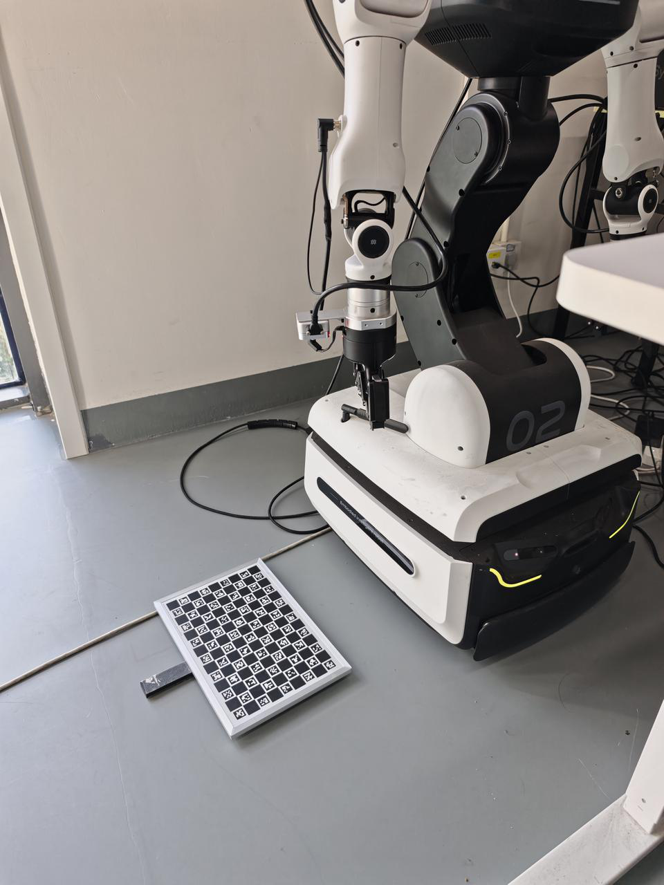
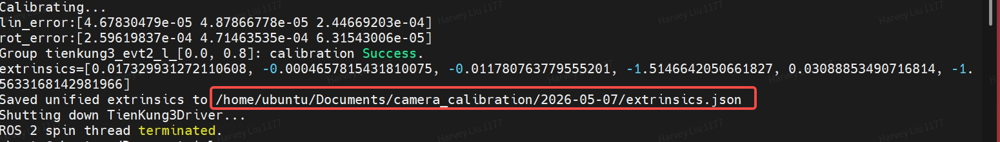
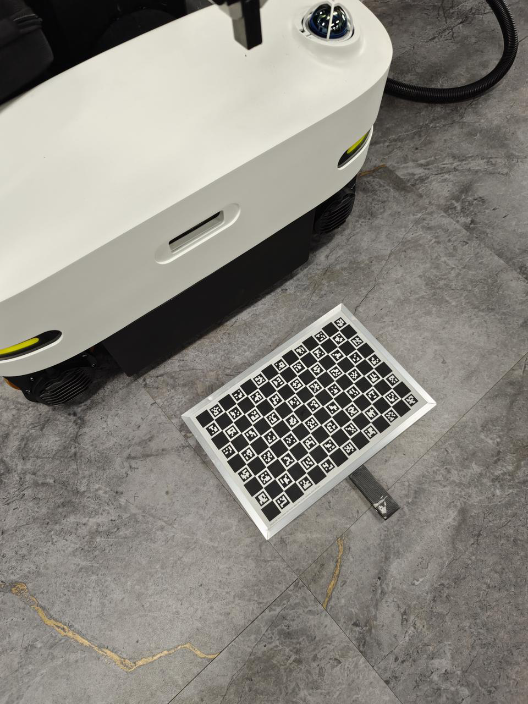
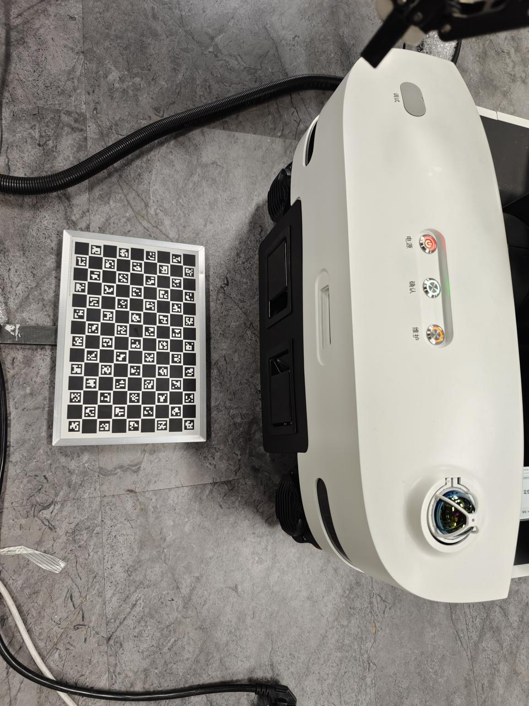

## 第1页

X-Humanoid 系列机器人相机外参标定流程​
时间
变更内容​
人员
2026年5月7日​
1. 文档创建​
a. 内容包含天轶 2.0 与天工 3.0 EVT 2 头部相机外参标定流程​
b. ​
​
robot-camera-calibration-version-1.0.zip
i.
md5sum 75c50fa873a78b292e25ea66bc581e96​
​
Chris Ren ​
​
Harvey Liu ​
2026年5月25
日​
1. 新增打包版标定程序​
a. 天轶​
tienyi2_calibration.tar.gz
b. 天工3.0​
​
tienkung3_calibration.tar.gz
​
Chris Ren ​
​
Harvey Liu ​
2026年6月30
日​
1. 新增天轶升级版头部相机标定程序​
a. 天轶升级版​
​
tienyi2_pro_arm_calibration.tar.gz
​
​
Chris Ren ​
Harvey Liu ​
1. 天轶 2.0 相机外参标定​
1. 将 Python 环境与标定程序拷贝到机器人 x86 系统​
a. 打包版​
​
tienyi2_calibration.tar.gz
代码块​
scp tienyi2_calibration.tar.gz ubuntu@192.168.41.1:/home/ubuntu/Documents/​
b. 源码版​
​
robot-camera-calibration-version-1.0.zip
代码块​
scp robot-camera-calibration-version-1.0.zip 
ubuntu@192.168.41.1:/home/ubuntu/Documents/​
2. 标定板安装后，需将手臂和标定板手动放在机器人前侧，防止胳膊刚开始运动时和机器人底盘碰撞​
3. 启动本体 body_control ROS 2 节点​
1
1

## 第2页

代
块ssh ubuntu@192.168.41.1​
(123)​
sudo su​
(123)​
​
source ros2ws/install/setup.bash​
ros2 launch body_control body.launch.py​
4. 启动相机 ROS 2 节点（头部/手眼相机二选一）
a. 头部相机​
代码块​
ssh nvidia@192.168.41.2​
(nvidia)​
​
source orbbec_camera_ros2/install/setup.bash​
ros2 launch orbbec_camera gemini_330_series.launch.py​
b. 手眼相机​
i.
需求方提供（当前仅适配realsense/orbbec相机）​
5. 启动相机外参标定程序​
a. 头部相机​
i.
打包版​
代码块​
ssh ubuntu@192.168.41.1​
(123)​
​
cd /home/ubuntu/Documents/​
tar -xzf tienyi2_calibration.tar.gz​
cd tienyi2_calibration​
source /home/ubuntu/ros2ws/install/setup.bash​
./calibrate_tienyi2 \​
    --config configs/tienyi2_head_camera_example.json \​
    --output-dir ~/Documents/camera_calibration \​
    --cali-num 100 \​
    --sleep-time 3.0​
ii. 源码版​
1
2
3
4
5
6
7
1
2
3
4
5
1
2
3
4
5
6
7
8
9
10
11
12

## 第3页

代码块​
ssh ubuntu@192.168.41.1​
(123)​
​
# 解压标定程序及 Python 环境​
cd /home/ubuntu/Documents/​
unzip robot-camera-calibration-version-1.0.zip​
tar -xzf robot-camera-calibration-version-
1.0/python_env/python_portable_3.10.20.tar.gz​
​
source /home/ubuntu/ros2ws/install/setup.bash​
# 执行外参标定流程​
./python/bin/python3 robot-camera-calibration-version-
1.0/scripts/calibrate_tienyi2_head_camera.py --config robot-camera-
calibration-version-1.0/scripts/configs/tienyi2_example.json --sleep-
time 3.0 --cali-num 100​
b. 手眼相机​
i.
打包版​
1. 左手​
代码块​
ssh ubuntu@192.168.41.1​
(123)​
​
cd /home/ubuntu/Documents/​
tar -xzf tienyi2_calibration.tar.gz​
cd tienyi2_calibration​
source /home/ubuntu/ros2ws/install/setup.bash​
./calibrate_tienyi2 \​
    --config configs/tienyi2_left_hand_camera_example.json \​
    --hand_camera \​
    --output-dir ~/Documents/camera_calibration \​
    --cali-num 100 \​
    --sleep-time 3.0​
2. 右手​
代码块​
ssh ubuntu@192.168.41.1​
(123)​
​
cd /home/ubuntu/Documents/​
tar -xzf tienyi2_calibration.tar.gz​
1
2
3
4
5
6
7
8
9
10
11
1
2
3
4
5
6
7
8
9
10
11
12
13
1
2
3
4
5

## 第4页

cd tienyi2_calibration​
source /home/ubuntu/ros2ws/install/setup.bash​
./calibrate_tienyi2 \​
    --config configs/tienyi2_right_hand_camera_example.json \​
    --hand_camera \​
    --output-dir ~/Documents/camera_calibration \​
    --cali-num 100 \​
    --sleep-time 3.0​
ii. 如果相机的ros话题名不是左手"/camera1/camera1/color/image_rect_raw"，右
手"/camera2/camera2/color/image_rect_raw" 。则需要手动配置话题名​
1. 解压后打开文件 
tienyi2_calibration/configs/tienyi2_left_hand_camera_example.json​
2. 在第4行中替换实际使用的topic（需使用方提供），例如：​
"topic": "/camera1/camera1/color/image_rect_raw", ​
iii. 标定机器人姿态和标定板放置示意图​
6. 保存外参标定结果​
a. 标定完成后会在终端显示标定结果的保存路径（如下所示），可按需将该文件拷贝保存即可。​
7. 清理相关文件​
代码块​
cd /home/ubuntu/Documents​
6
7
8
9
10
11
12
13
1

## 第5页

sudo rm -rf python/ robot-camera-calibration-version-1.0/ 
camera_calibration/ robot-camera-calibration-version-1.0.zip​
(123)​
2. 天工 3.0 EVT 2 头部相机外参标定​
1. 将 Python 环境与标定程序拷贝到机器人 x86 系统​
a. 打包版​
​
tienkung3_calibration.tar.gz
代码块​
scp tienkung3_calibration.tar.gz ubuntu@192.168.41.1:/home/ubuntu/Documents/​
b. 源码版​
​
robot-camera-calibration-version-1.0.zip
代码块​
scp robot-camera-calibration-version-1.0.zip 
ubuntu@192.168.41.1:/home/ubuntu/Documents/​
2. 启动机器人​
a. 若机器人打开了自启流程​
i.
将机器人按标准流程切换至半身行走模式​
b. 若机器人关闭了自启流程​
i.
启动本体 robot_control ROS 2 节点​
代码块​
ssh ubuntu@192.168.41.1​
(123)​
sudo su​
(123)​
​
source /home/ubuntu/xos/setup.bash​
bash /home/ubuntu/xos/robot_control/share/scripts/robot_control_xos.sh​
3. 启动头部相机 ROS 2 节点​
代码块​
ssh nvidia@192.168.41.2​
2
3
1
1
1
2
3
4
5
6
7
1

## 第6页

(nvidia)​
​
source xos/setup.bash​
ros2 launch orbbec_camera head_330_tg30_thor.launch.py color_width:=640 
color_height:=480 color_fps:=30​
4. 启动头部相机外参标定程序​
a. 打包版​
代码块​
ssh ubuntu@192.168.41.1​
(123)​
​
cd /home/ubuntu/Documents/​
tar -xzf tienkung3_calibration.tar.gz​
cd tienkung3_calibration​
source /home/ubuntu/xos/setup.bash​
./calibrate_tienkung3 \​
       --config configs/tienkung3_example.json \​
       --output-dir ~/Documents/camera_calibration \​
       --cali-num 100 \​
       --sleep-time 3.0​
b. 源码版​
代码块​
ssh ubuntu@192.168.41.1​
(123)​
​
# 解压标定程序及 Python 环境​
cd /home/ubuntu/Documents/​
unzip robot-camera-calibration-version-1.0.zip​
tar -xzf robot-camera-calibration-version-
1.0/python_env/python_portable_3.12.13.tar.gz​
​
# 执行外参标定流程​
source /home/ubuntu/xos/setup.bash​
./python/bin/python3 robot-camera-calibration-version-
1.0/scripts/calibrate_tienkung3_head_camera.py --config robot-camera-
calibration-version-1.0/scripts/configs/tienkung3_example.json --sleep-time 
5.0 --cali-num 100​
2
3
4
5
1
2
3
4
5
6
7
8
9
10
11
12
1
2
3
4
5
6
7
8
9
10
11

## 第7页

5. 保存外参标定结果​
a. 标定完成后会在终端显示标定结果的保存路径（如下所示），可按需将该文件拷贝保存即可。​
6. 清理相关文件​
代码块​
cd /home/ubuntu/Documents​
sudo rm -rf python/ robot-camera-calibration-version-1.0/ 
camera_calibration/ robot-camera-calibration-version-1.0.zip​
(123)​
3. 天轶升级版相机外参标定​
3.1 头部相机标定流程​
1. 将 Python 环境与标定程序拷贝到机器人 arm（thor） 系统​
a. 打包版​
​
tienyi2_pro_arm_calibration.tar.gz
代码块​
scp tienyi2_pro_arm_calibration.tar.gz 
nvidia@192.168.41.2:/home/ubuntu/Documents/​
2. 启动机器人​
a. 启动相机及body相关节点，确保头部相机和 /body_state 话题可正常订阅​
3. 启动头部相机外参标定程序​
a. 打包版​
代码块​
ssh nvidia@192.168.41.2​
(nvidia)​
​
cd /home/ubuntu/Documents/​
tar -xzf tienyi2_pro_arm_calibration.tar.gz​
cd tienyi2_pro_arm_calibration/​
1
2
3
1
1
2
3
4
5
6

## 第8页

source ~/xos/setup.bash​
./calibrate_tienyi2_pro_arm \​
       --config configs/tienyi2_pro_head_camera_example.json \​
       --output-dir ~/Documents/camera_calibration \​
       --cali-num 100 \​
       --sleep-time 15.0​
3.2 手眼相机标定流程​
a. 遥操作取点流程（仅面向研发）​
​
遥操作取点流程​
b. 将 Python 环境与标定程序拷贝到机器人 arm（thor） 系统​
i.
打包版​
​
tienyi2_pro_arm_calibration.tar.gz
代码块​
scp tienyi2_pro_arm_calibration.tar.gz 
nvidia@192.168.41.2:/home/ubuntu/Documents/​
c. 启动机器人​
i.
启动相机及body相关节点，确保头部相机和 /body_state 话题可正常订阅​
d. 启动手眼相机外参标定程序（打包版）​
代码块​
ssh nvidia@192.168.41.2​
(nvidia)​
​
cd /home/nvidia/Documents/​
tar -xzf tienyi2_pro_arm_calibration.tar.gz​
cd tienyi2_pro_arm_calibration/​
source ~/xos/setup.bash​
i.
D405相机​
1. 左胳膊​
代码块​
./calibrate_tienyi2_pro_arm \​
       --config 
configs/tienyi2_pro_hand_left_camera_D405_example.json \​
       --output-dir ~/Documents/camera_calibration \​
7
8
9
10
11
12
1
1
2
3
4
5
6
7
1
2
3

## 第9页

       --hand_camera \​
       --cali-num 100 \​
       --sleep-time 5.0​
a. 标定版放置示意​
2. 右胳膊​
代码块​
./calibrate_tienyi2_pro_arm \​
       --config 
configs/tienyi2_pro_hand_right_camera_D405_example.json \​
       --output-dir ~/Documents/camera_calibration \​
       --hand_camera \​
       --cali-num 100 \​
       --sleep-time 5.0​
a. 标定版放置示意​
ii. 336相机​
1. 左胳膊​
4
5
6
1
2
3
4
5
6

## 第10页

代码块​
./calibrate_tienyi2_pro_arm \​
       --config 
configs/tienyi2_pro_hand_left_camera_336_example.json \​
       --output-dir ~/Documents/camera_calibration \​
       --hand_camera \​
       --cali-num 100 \​
       --sleep-time 5.0​
a. 标定版放置示意：同D405相机​
2. 右胳膊​
代码块​
./calibrate_tienyi2_pro_arm \​
       --config 
configs/tienyi2_pro_hand_right_camera_336_example.json \​
       --output-dir ~/Documents/camera_calibration \​
       --hand_camera \​
       --cali-num 100 \​
       --sleep-time 5.0​
a. 标定版放置示意：同D405相机​
e. 标定结果​
i.
手眼相机标定的外参为相机光心到 left/right_tcp_link​
ii. 示例​
​
​
extrinsics_left.json
​
​
extrinsics_right.json
4. 其他​
4.1 文档适用范围​
当前仅限生产、售后和公司内研发同事使用​
4.2 需重新标定的情况​
i.
头部相机​
相机光心到头部最后一个关节（天工3.0为head_pitch_link，天轶为head_roll_link）间的任何
硬件有任何变动，如旋转/移动/拆装/拧紧/更换等行为，需要重新标定。除此之外理论上无需标
1
2
3
4
5
6
1
2
3
4
5
6

## 第11页

定​
ii. 手眼相机​
相机光心到末端 （left/right_tcp_link） 间的任何硬件有任何变动，如旋转/移动/拆装/拧紧/更
换等行为，需要重新标定。除此之外理论上无需标定​
4.3 手眼相机标定，标定版放置规则​
确保手眼相机可完全看到即可（生成的中间图像文件中标定版超出画面超过30%的小于总
数的10%），可依据相机安装位置或生成的图像文件微调标定版位置

